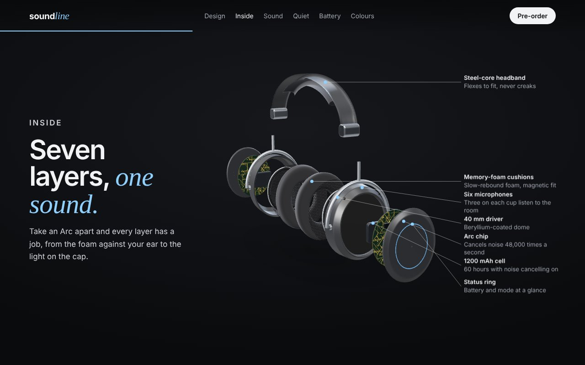
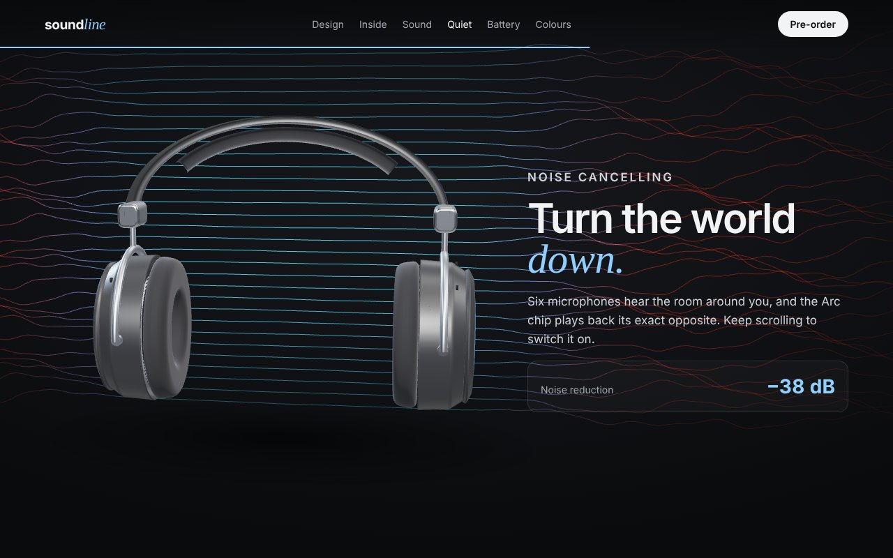

# Soundline

A scroll-driven 3D product page for a pair of headphones that don't exist. As you scroll, the Soundline Arc turns to show its design, comes apart into its seven layers, takes you up close to its driver, cancels the noise around it, charges its battery and changes colour. All of it is built from code in Three.js: there are no model files, images or audio files to download.

**[Open the page →](https://dandee057.github.io/soundline/)**



> Soundline and the Arc are made up. This is a portfolio piece showing the kind of scroll-driven 3D product page brands use to launch hardware.

## What happens as you scroll

| Chapter | The 3D scene |
| --- | --- |
| Quiet, by design | The headphones float and sway; drag to turn them |
| Machined, not moulded | The camera swings round to a side view |
| Seven layers, one sound | Every part slides apart along its cup's axis, then labels pin themselves to the parts |
| Big sound, small cone | Close up on the driver. **Play the demo loop** and the cone moves with the bass |
| Turn the world down | A wall of noisy sound waves; scrolling switches noise cancelling on and the waves near the cups go calm |
| 60 hours | The cup opens, the battery glows and the hours count up |
| Four finishes | Pick a colourway: the materials, the page and the accent colour all change together |

It works on phones (the product sits above a text sheet), with a keyboard, and with *reduce motion* turned on (no smooth scrolling or idle animation; the scene still follows your scroll).



## How it works

**One timeline, driven by the scrollbar.** The story is a list of keyframes in [`src/story.ts`](src/story.ts), each pinned to a chapter and a point within it: camera orbit, how exploded the headphones are, the label opacity, the noise-cancelling amount, the battery charge. `schedule()` turns them into pixel positions on the page, and [`src/main.ts`](src/main.ts) builds one GSAP timeline from them where one second equals one pixel of scroll. ScrollTrigger scrubs it, and Lenis smooths the scroll. Every frame, the scene reads one plain `state` object, so the same scroll position always gives the same picture. The timeline is rebuilt when the window resizes.

**Modelled in code.** [`src/scene/headphones.ts`](src/scene/headphones.ts) builds the headphones from lathes (cups, cushions, cone), a swept squircle profile (the headband, [`geometry.ts`](src/scene/geometry.ts)), tori, rounded boxes and canvas-drawn textures (grille, circuit board, battery label). Each cup is a stack of parts on one axis, so the exploded view moves every part along that axis by its own distance. The materials are physically based: clearcoat on the shell, sheen on the cushions, and reflections from a generated `RoomEnvironment`, so there's no HDR file to load.

**A custom shader for the noise.** [`src/scene/field.ts`](src/scene/field.ts) draws 30 lines of sound waves. The vertex shader shakes them with layered sine noise and calms them near the cups as noise cancelling turns up. The calm lines take on the finish's colour.

**Labels in HTML, pinned to 3D.** [`src/callouts.ts`](src/callouts.ts) projects each part's anchor to the screen every frame and lines the labels up in a column beside the product, in the same order as their parts, so the leader lines don't cross. Being real text, the labels stay sharp and screen readers can read them.

**Sound from nothing.** [`src/audio.ts`](src/audio.ts) synthesises a short loop with the Web Audio API (kick, bass, pad, hats). An analyser measures the low end, and that moves the driver cones.

**Light on the device.** There's no shadow map (a soft contact shadow texture instead), no post-processing, the pixel ratio is capped, and the text is all HTML. If WebGL isn't available, the page is still a complete, readable product page.

## Running it

```bash
npm install
npm run dev      # http://localhost:5173
npm test         # the story's keyframe scheduling and colour data
npm run build    # type-checks, then builds to dist/
```

**Deploying:** in the repository, go to *Settings → Pages* and set *Source* to **GitHub Actions**. Every push to `main` then tests, builds and deploys through [`.github/workflows/deploy.yml`](.github/workflows/deploy.yml).

## Project structure

```
index.html             the page: every chapter's text, the nav, specs
src/main.ts            scroll timeline, smooth scroll, chapters, colours, drag, the frame loop
src/story.ts           the keyframes, and schedule() that places them on the page
src/colourways.ts      the four finishes
src/callouts.ts        labels pinned to 3D parts
src/audio.ts           the synthesised demo loop and its bass meter
src/scene/stage.ts     renderer, studio light, camera orbit, view offset
src/scene/headphones.ts  the headphones: parts, exploded view, materials
src/scene/geometry.ts  sweep, lathe, rounded outline and rounded box helpers
src/scene/field.ts     the noise-cancelling wave shader
src/scene/textures.ts  grille, circuit board, battery label and shadow, drawn on a canvas
src/style.css          layout, type, phone layout
tests/                 keyframe scheduling and colour data
```

## Built with

Three.js · GSAP + ScrollTrigger · Lenis · TypeScript · Vite

## Licence

MIT
